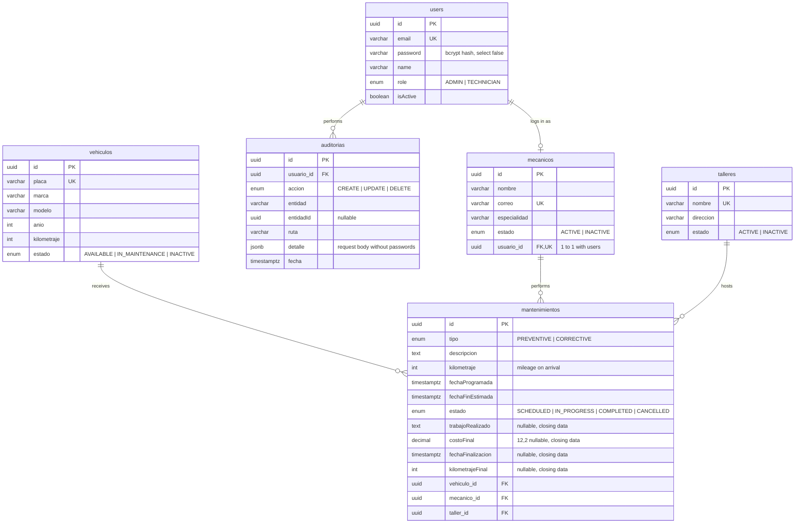
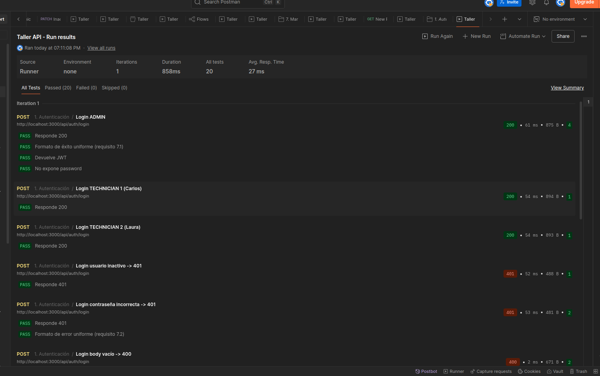
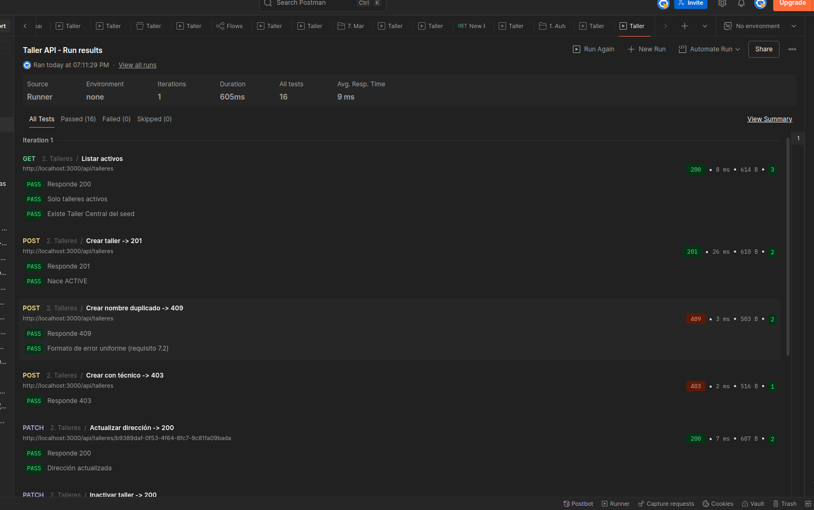
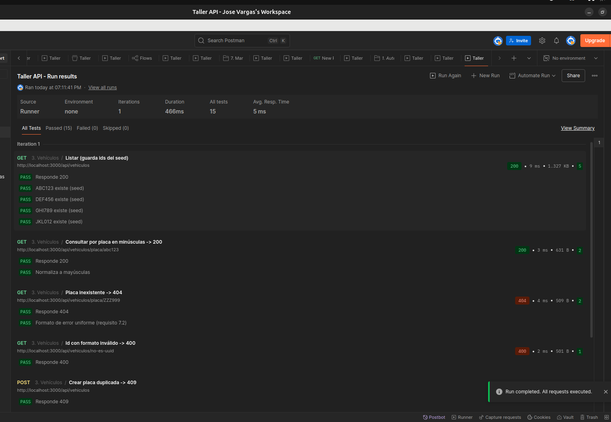
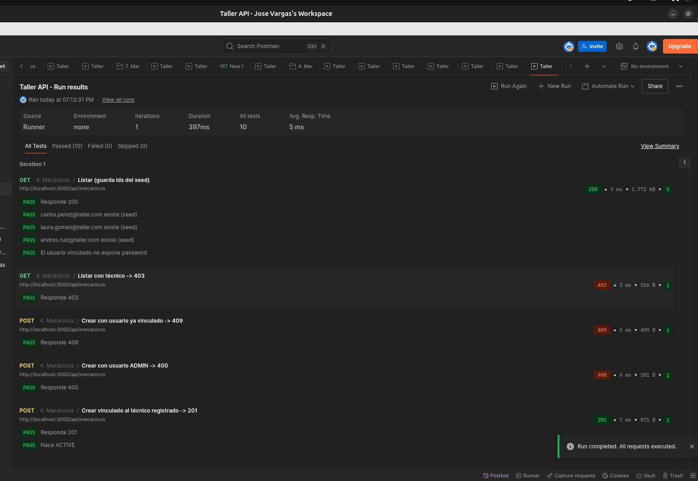
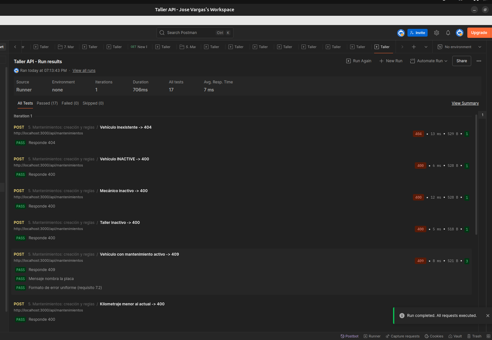
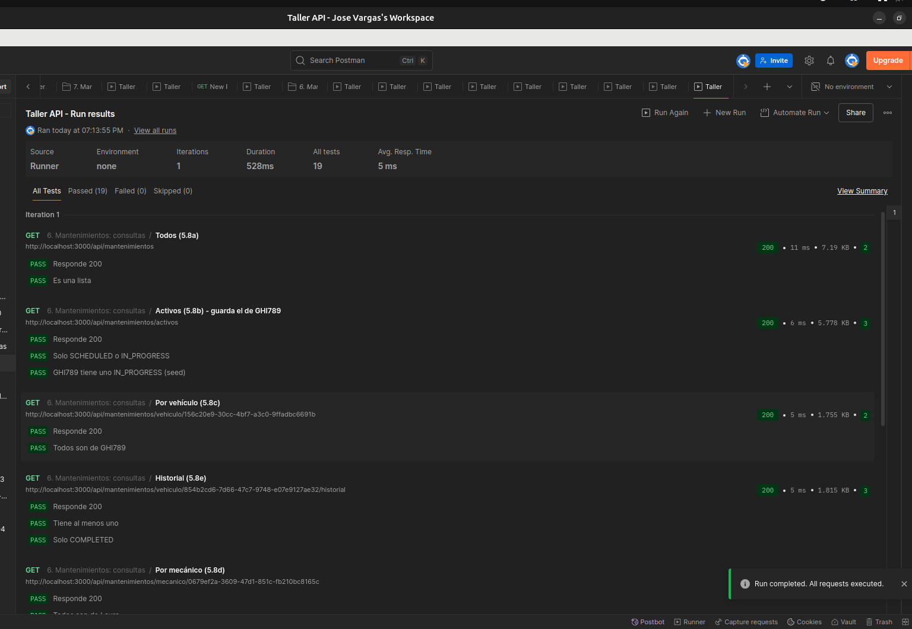
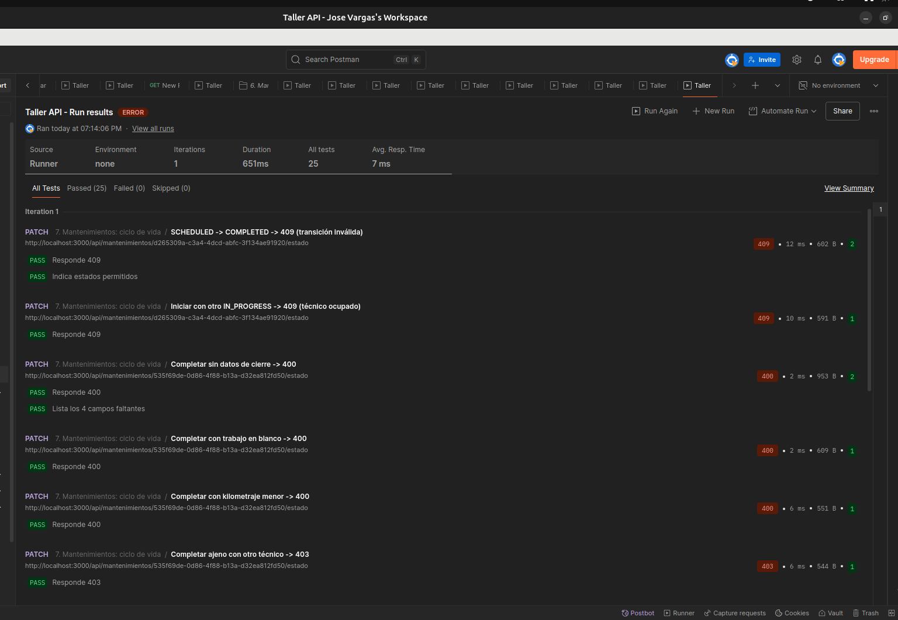
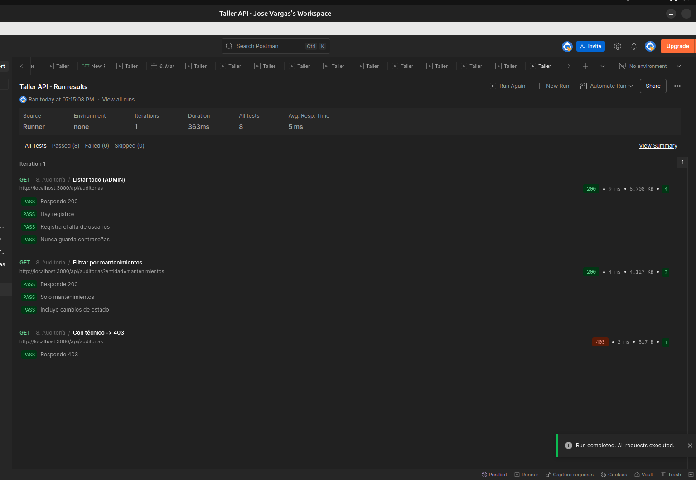
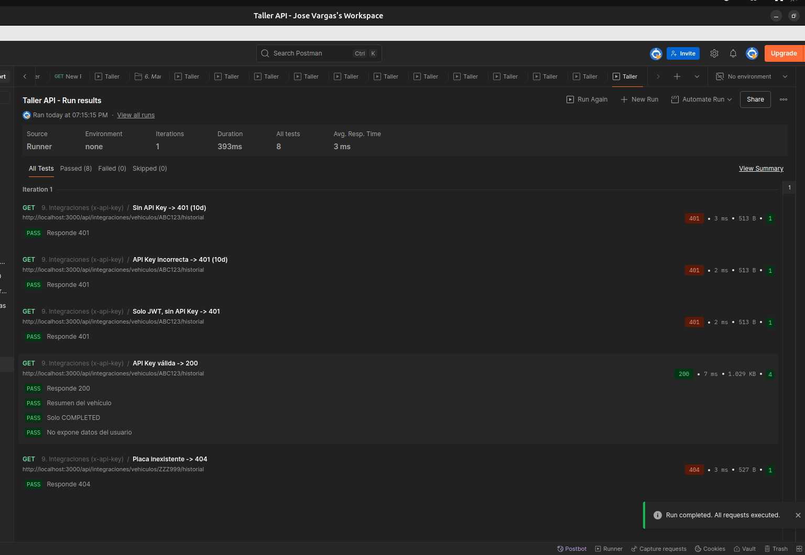

# Workshop API

REST API to manage the full lifecycle of maintenance work on a company's vehicle fleet: vehicles, mechanics, workshops and maintenance jobs, with JWT authentication, role-based authorization, change auditing and an integration endpoint protected by an API key.

**Author:** Jose Vargas

> API routes, request/response fields, and messages use English. To preserve existing data, the database still uses its original Spanish table and column names; the TypeORM entities explicitly map between them.

## Contents

- [Stack](#stack)
- [Swagger documentation](#swagger-documentation)
- [Running locally](#running-locally)
- [Docker deployment](#docker-deployment)
- [Environment variables](#environment-variables)
- [Seed users and data](#seed-users-and-data)
- [Data model](#data-model)
- [Roles and permissions](#roles-and-permissions)
- [Endpoints](#endpoints)
- [Maintenance lifecycle](#maintenance-lifecycle)
- [Business rules](#business-rules)
- [Response format](#response-format)
- [Design decisions](#design-decisions)
- [Testing](#testing)
- [Scripts](#scripts)
- [Project structure](#project-structure)
- [Known limitations](#known-limitations)

## Stack

- NestJS + TypeScript (ESM)
- TypeORM + PostgreSQL 16
- JWT (`@nestjs/jwt`) and bcrypt for password hashing
- class-validator for DTOs and Zod for environment variable validation
- Swagger (OpenAPI)
- Docker and Docker Compose

## Swagger documentation

With the application running:

**http://localhost:3000/docs**

To try protected endpoints: log in, copy the `accessToken` and paste it into the **Authorize** button (`bearer` scheme). For the integration endpoint, use the `x-api-key` field in the same dialog. The token is kept across page reloads.

## Running locally

Requirements: Node.js 20.6 or later and PostgreSQL 16 installed locally.

```bash
# 1. Dependencies
npm install

# 2. Environment variables
cp .env.example .env

# 3. Database
createdb -h localhost -U postgres taller_db

# 4. Seed data (safe to run more than once, it never duplicates records)
npm run seed

# 5. Start the API
npm run start:dev
```

The API is served at `http://localhost:3000/api`. In development, tables are created automatically from the entities (`synchronize`).

## Docker deployment

`docker-compose.yml` starts the API and PostgreSQL on an internal network (`workshop-net`), with a named volume (`pgdata`) so data persists across restarts.

```bash
cp .env.example .env
docker compose up -d --build

# Seed the database inside the container
docker compose exec api node dist/database/seeds/seed.js
```

- API: `http://localhost:3000/api`
- Swagger: `http://localhost:3000/docs`

| Service | Image                                     | Details                                                                                                                |
| ------- | ----------------------------------------- | ---------------------------------------------------------------------------------------------------------------------- |
| `db`    | `postgres:16-alpine`                      | No port published to the host: reachable only from the internal network. Health check with `pg_isready`                |
| `api`   | Multi-stage Dockerfile (`node:22-alpine`) | Starts once the database is ready (`service_healthy`) and reaches it by the service name `db`. Runs as a non-root user |

The Dockerfile compiles in a first stage (with the build tools `bcrypt` needs) and copies only the compiled code and production dependencies into the final image. The `.env` file never goes into the image: variables are provided by `docker-compose.yml`.

Useful commands:

```bash
docker compose ps              # service status
docker compose logs -f api     # API logs
docker compose down            # stop (data is kept in the volume)
docker compose down -v         # stop and delete the data
```

The container database is independent from a local PostgreSQL installation. `NODE_ENV` is read from `.env`; with `development`, TypeORM creates the tables on startup.

## Environment variables

All variables are validated with Zod on startup (`src/config/env.schema.ts`): if one is missing or invalid, the application refuses to start and reports which one.

| Variable                                                                              | Description                                                               |
| ------------------------------------------------------------------------------------- | ------------------------------------------------------------------------- |
| `NODE_ENV`                                                                            | `development`, `production` or `test`                                     |
| `PORT`                                                                                | Server port (default 3000)                                                |
| `API_PREFIX`                                                                          | Route prefix (default `api`)                                              |
| `POSTGRES_HOST`, `POSTGRES_PORT`, `POSTGRES_USER`, `POSTGRES_PASSWORD`, `POSTGRES_DB` | PostgreSQL connection                                                     |
| `JWT_SECRET`                                                                          | Token signing secret (at least 32 characters)                             |
| `JWT_EXPIRES_IN`                                                                      | Token lifetime (e.g. `1h`; use `30s` to test expiration)                  |
| `API_KEY`                                                                             | Value of the `x-api-key` header for integrations (at least 16 characters) |

## Seed users and data

The seed (`npm run seed`) creates:

| Email               | Password      | Role                               | Status   |
| ------------------- | ------------- | ---------------------------------- | -------- |
| admin@workshop.com    | `Admin123*`   | ADMIN                              | Active   |
| tecnico1@workshop.com | `Tecnico123*` | TECHNICIAN (mechanic Carlos Pérez) | Active   |
| tecnico2@workshop.com | `Tecnico123*` | TECHNICIAN (mechanic Laura Gómez)  | Active   |
| tecnico3@workshop.com | `Tecnico123*` | TECHNICIAN (mechanic Andrés Ruiz)  | Inactive |

- **Mechanics:** Carlos and Laura active and linked to their users; Andrés inactive.
- **Workshops:** `Taller Central` (active) and `Taller Norte` (inactive; these are the existing seed record names).
- **Vehicles:** ABC123 and DEF456 `AVAILABLE`, GHI789 `IN_MAINTENANCE`, JKL012 `INACTIVE`.
- **Maintenance jobs:**
  - ABC123: `COMPLETED` (feeds the vehicle history).
  - GHI789: `IN_PROGRESS`, assigned to Laura.
  - DEF456: `SCHEDULED`, assigned to Carlos.

The seed is idempotent: each record is looked up by a natural key (email, mechanic email, plate, name) before being created, and everything runs in a single transaction. Running it twice does not duplicate data.

## Data model



| Table            | Meaning                                                                  |
| ---------------- | ------------------------------------------------------------------------ |
| `vehiculos`      | Fleet vehicles (`placa` = license plate, `kilometraje` = mileage)        |
| `mecanicos`      | Mechanics, each linked to a TECHNICIAN user                              |
| `talleres`       | Workshops                                                                |
| `mantenimientos` | Maintenance jobs                                                         |
| `auditorias`     | Audit log                                                                 |

Every table also has `createdAt` and `updatedAt` (except `auditorias`, which only has `fecha` because audit entries are never edited); they are omitted from the diagram for clarity.

A mechanic is not tied to a workshop: the link exists only inside each maintenance job, because a mechanic can work at different workshops.

**Partial unique indexes on `mantenimientos`:**

- `vehiculo_id` where `estado IN ('SCHEDULED', 'IN_PROGRESS')`: one active maintenance job per vehicle.
- `mecanico_id` where `estado = 'IN_PROGRESS'`: one in-progress job per technician.

## Roles and permissions

| Action                                       | ADMIN |  TECHNICIAN   |
| -------------------------------------------- | :---: | :-----------: |
| Register users                               |  Yes  |      No       |
| Manage vehicles, mechanics and workshops     |  Yes  |      No       |
| View vehicles and workshops                  |  Yes  |      Yes      |
| Create maintenance jobs and view all of them |  Yes  |      No       |
| View their own assigned jobs                 |   —   |      Yes      |
| Start and complete a maintenance job         |  Yes  | Own jobs only |
| Cancel a maintenance job                     |  Yes  |      No       |
| View audit logs                              |  Yes  |      No       |

Only an ADMIN can register users, so nobody can create an account with permissions on their own. The first administrator is created by the seed.

## Endpoints

All routes are prefixed with `/api` and require a JWT, except login and integrations.

### Authentication

| Method | Route            | Access        |
| ------ | ---------------- | ------------- |
| POST   | `/auth/login`    | Public        |
| POST   | `/auth/register` | ADMIN         |
| GET    | `/auth/profile`  | Authenticated |

### Users (ADMIN only)

`GET /users`, `GET /users/:id`, `PATCH /users/:id` (also activates or deactivates through `isActive`)

### Vehicles

| Method | Route                      | Access        |
| ------ | -------------------------- | ------------- |
| GET    | `/vehicles`               | Authenticated |
| GET    | `/vehicles/:id`           | Authenticated |
| GET    | `/vehicles/plate/:plate`  | Authenticated |
| POST   | `/vehicles`               | ADMIN         |
| PATCH  | `/vehicles/:id`           | ADMIN         |
| PATCH  | `/vehicles/:id/deactivate` | ADMIN         |

### Mechanics (ADMIN only)

`GET /mechanics`, `GET /mechanics/:id`, `POST /mechanics`, `PATCH /mechanics/:id`, `PATCH /mechanics/:id/activate`, `PATCH /mechanics/:id/deactivate`

### Workshops

| Method | Route                                                 | Access        |
| ------ | ----------------------------------------------------- | ------------- |
| GET    | `/workshops` (active only)                             | Authenticated |
| GET    | `/workshops/:id`                                       | Authenticated |
| POST   | `/workshops`                                           | ADMIN         |
| PATCH  | `/workshops/:id`                                       | ADMIN         |
| PATCH  | `/workshops/:id/activate` and `/workshops/:id/deactivate` | ADMIN         |

### Maintenance jobs

| Method | Route                                            | Access                            |
| ------ | ------------------------------------------------ | --------------------------------- |
| POST   | `/maintenances`                                | ADMIN                             |
| GET    | `/maintenances`                                | ADMIN                             |
| GET    | `/maintenances/active`                        | ADMIN                             |
| GET    | `/maintenances/vehicle/:vehicleId`           | ADMIN                             |
| GET    | `/maintenances/vehicle/:vehicleId/history` | ADMIN                             |
| GET    | `/maintenances/mechanic/:mechanicId`           | ADMIN                             |
| GET    | `/maintenances/assigned-to-me`                  | TECHNICIAN                        |
| GET    | `/maintenances/:id`                            | ADMIN, TECHNICIAN (own jobs only) |
| PATCH  | `/maintenances/:id/status`                     | ADMIN, TECHNICIAN (own jobs only) |

`/vehicle/:id` returns every maintenance job of the vehicle in any status; `/history` returns only the `COMPLETED` ones, newest first.

### Audit logs (ADMIN only)

`GET /audits`, with an optional filter: `GET /audits?entity=maintenances`

### External integrations (API key)

```bash
curl -H "x-api-key: <API_KEY from .env>" \
  http://localhost:3000/api/integrations/vehicles/ABC123/history
```

A missing or wrong key returns `401`. This endpoint does not accept a JWT: it is meant for other systems, not for users. It returns a summary without internal data (no users, emails or timestamps):

```json
{
  "success": true,
  "statusCode": 200,
  "timestamp": "2026-10-27T21:08:28.283Z",
  "data": {
    "vehicle": {
      "id": "...",
      "plate": "ABC123",
      "make": "Chevrolet",
      "model": "Spark",
      "available": true
    },
    "maintenances": [
      {
        "id": "...",
        "type": "PREVENTIVE",
        "status": "COMPLETED",
        "description": "Oil and filter change",
        "workPerformed": "Changed 5W-30 oil, oil filter, and air filter",
        "mileage": 45000,
        "finalMileage": 45200,
        "cost": 250000,
        "completedAt": "2026-09-15T14:00:00.000Z",
        "mechanic": { "id": "...", "name": "Carlos Pérez" },
        "workshop": { "id": "...", "name": "Taller Central" }
      }
    ]
  }
}
```

## Maintenance lifecycle

```
SCHEDULED ──> IN_PROGRESS ──> COMPLETED
    │              │
    └──> CANCELLED <┘
```

| Transition              | Who                          | Effect on the vehicle                |
| ----------------------- | ---------------------------- | ------------------------------------ |
| SCHEDULED → IN_PROGRESS | ADMIN or assigned technician | Becomes `IN_MAINTENANCE`             |
| IN_PROGRESS → COMPLETED | ADMIN or assigned technician | Back to `AVAILABLE`, mileage updated |
| IN_PROGRESS → CANCELLED | ADMIN                        | Back to `AVAILABLE`                  |
| SCHEDULED → CANCELLED   | ADMIN                        | No change                            |

`COMPLETED` and `CANCELLED` are final states. Every job starts as `SCHEDULED`: the creation DTO does not accept an `status` field.

Completing a job requires the work performed, final cost, completion date and final mileage. The status change of the job and of the vehicle are saved in a single transaction: if either write fails, both are rolled back.

## Business rules

| Rule                                                                                           | Response                          |
| ---------------------------------------------------------------------------------------------- | --------------------------------- |
| Vehicle, mechanic or workshop does not exist when creating a job                               | `404`                             |
| Vehicle, mechanic or workshop is inactive                                                      | `400`                             |
| The vehicle already has an active job (`SCHEDULED` or `IN_PROGRESS`)                           | `409`                             |
| The mechanic has another job with an overlapping schedule, at the same or a different workshop | `409`                             |
| The technician tries to start a job while another one is in progress                           | `409`                             |
| Mileage lower than the vehicle's current mileage (on creation or completion)                   | `400`                             |
| Completing without the required closing data, or with a blank work description                 | `400`                             |
| Invalid status transition or change from a final state                                         | `409`, listing the allowed states |
| A technician acts on a job not assigned to them                                                | `403`                             |
| Deactivating a vehicle with a job in progress                                                  | `409`                             |

**Schedule overlap:** two jobs overlap when one starts before the other ends. A 7:30 to 9:00 job and another starting at 9:00 are both valid, because comparisons are strict. The rule applies per mechanic, regardless of the workshop.

**Soft delete:** vehicles, mechanics, workshops and users are never deleted; they are deactivated to preserve the maintenance history.

## Response format

**Success** (global interceptor):

```json
{
  "success": true,
  "statusCode": 200,
  "timestamp": "2026-10-27T19:00:00.000Z",
  "data": {}
}
```

**Error** (global exception filter):

```json
{
  "success": false,
  "statusCode": 409,
  "timestamp": "2026-10-27T19:00:00.000Z",
  "path": "/api/maintenances",
  "method": "POST",
  "message": "Vehicle DEF456 already has an active maintenance (SCHEDULED)"
}
```

Validation errors also include `errors` with the list of invalid fields.

Validation, authentication, authorization, not-found and conflict errors (including database unique-constraint violations) are never turned into `500`. An unexpected error returns `500` with a generic message; the details (SQL, stack trace) are only written to the server log.

| Code  | When                                                                                    |
| ----- | --------------------------------------------------------------------------------------- |
| `400` | Bad input: invalid DTO, reversed dates, lower mileage, inactive entity                  |
| `401` | Missing, invalid or expired token; missing or wrong API key; wrong credentials          |
| `403` | Role not allowed, or a technician acting on someone else's job                          |
| `404` | Resource not found                                                                      |
| `409` | Conflict with the current state: duplicates, overlapping schedules, invalid transitions |

## Design decisions

- **Secure by default:** `JwtAuthGuard` and `RolesGuard` are registered globally. Every route is private unless marked with `@Public()`.
- **Three custom decorators:** `@Roles()` declares the allowed roles, `@Public()` skips the JWT check and `@CurrentUser()` injects the token's user into the controller.
- **API key with its own guard:** `ApiKeyGuard` is applied only to the integrations controller and compares keys with `timingSafeEqual`, so response time does not reveal how many characters match.
- **`password` with `select: false`:** the hash never travels in responses, not even inside relations. Only the login explicitly requests it.
- **bcrypt with a 72-character limit:** bcrypt ignores anything beyond 72 bytes, so the DTO rejects longer passwords instead of silently truncating them.
- **`estimatedEndAt` (estimated end date):** not required by the spec, but the schedule-overlap rule cannot be enforced without an end time.
- **Dates as `timestamptz`:** stored with time zone, so a 7:30 appointment in Bogotá does not shift depending on where the server runs.
- **Cost as `decimal(12,2)`:** money is never stored as `float`, which accumulates rounding errors.
- **Uniqueness rules also enforced in the database:** one active job per vehicle and one in-progress job per technician are guaranteed by partial unique indexes, in case two requests arrive at the same time.
- **409 for invalid transitions:** the request is well-formed but conflicts with the resource's current state.
- **Auditing with a global interceptor:** every successful write by an authenticated user is recorded automatically (who, what, when and with which data, without passwords), with no repeated code in each service. It lives in the `audits` module because it depends on that module's service.
- **One-directional relations:** entities reference each other in a single direction only, to avoid circular imports under ESM.

## Testing

### Unit tests

```bash
npm test
```

They cover the status transition table, password stripping before auditing, the roles guard and the users service.

### Postman

The [Postman collection](./postman_collection.json) walks through the API with automated tests: each request checks the HTTP status and response content, and stores tokens and ids for subsequent requests.

**How to run it:**

1. Freshly seeded development database: stop the API, then run `npm run db:reset` followed by `npm run start:dev`. **This drops every table in the configured database and recreates the seed data; do not run it against data you need to keep.**
2. Import the collection into Postman and set the `apiKey` collection variable to the `API_KEY` value from `.env`.
3. Run the whole collection in order (**Run collection**).

The collection changes the data (it completes and cancels jobs) and each folder uses ids stored by the previous ones. It must always run complete, in order and against a freshly seeded database.

**Results:**

| #   | Folder                          | Requests |  Tests  |   Result    |
| --- | ------------------------------- | :------: | :-----: | :---------: |
| 1   | Authentication                  |    13    |   20    |    20/20    |
| 2   | Workshops                       |    9     |   16    |    16/16    |
| 3   | Vehicles                        |    8     |   15    |    15/15    |
| 4   | Mechanics                       |    5     |   10    |    10/10    |
| 5   | Maintenance: creation and rules |    14    |   17    |    17/17    |
| 6   | Maintenance: queries            |    10    |   19    |    19/19    |
| 7   | Maintenance: lifecycle          |    15    |   25    |    25/25    |
| 8   | Audit logs                      |    3     |    8    |     8/8     |
| 9   | Integrations (x-api-key)        |    5     |    8    |     8/8     |
|     | **Total**                       |  **82**  | **138** | **138/138** |

**What is verified:**

- **Authentication:** login for each role; inactive user, wrong password, missing token and invalid token → `401`; technician trying to register users → `403`; registration never returns the password.
- **Format:** success and error responses follow the uniform structure.
- **Vehicles, mechanics and workshops:** duplicates → `409`, invalid data → `400`, inactive records hidden from listings, no `password` in relations.
- **Business rules:** non-existent (`404`) or inactive (`400`) entities, vehicle with another active job (`409`), lower mileage (`400`) and the schedule-overlap cases.
- **Lifecycle:** invalid transitions and final states (`409`), incomplete or blank closing data (`400`), technician with another job in progress (`409`), effect of each transition on the vehicle, only ADMIN can cancel.
- **Queries:** all five query types; a technician cannot see other technicians' jobs (`403`).
- **Audit logs:** changes are recorded and passwords are never stored.
- **Integrations:** missing key, wrong key or JWT only → `401`; summarized response without internal data.

**Screenshots:**

|                                                          |                                                          |
| -------------------------------------------------------- | -------------------------------------------------------- |
|  |  |
|  |  |
|  |  |
|  |  |
|  | |

## Scripts

| Script              | Description                                                                                    |
| ------------------- | ---------------------------------------------------------------------------------------------- |
| `npm run start:dev` | Development server                                                                             |
| `npm run build`     | Compile                                                                                        |
| `npm run seed`      | Seed the database                                                                              |
| `npm run db:reset`  | Drop all tables and reseed the configured database (development only; destructive)              |
| `npm test`          | Unit tests                                                                                     |
| `npm run lint`      | Static analysis                                                                                |

## Project structure

```
src/
├── common/
│   ├── decorators/      @Roles, @Public, @CurrentUser
│   ├── enums/           shared roles and statuses
│   ├── filters/         global exception filter
│   ├── guards/          JwtAuthGuard, RolesGuard, ApiKeyGuard
│   ├── interceptors/    response format and logging
│   └── middleware/      request logging
├── config/              .env validation, TypeORM and Swagger
├── database/seeds/      seeder
└── modules/
    ├── auth/            login and registration
    ├── users/           user management
    ├── vehicles/       vehicles
    ├── mechanics/       mechanics
    ├── workshops/        workshops
    ├── maintenances/  maintenance lifecycle and business rules
    ├── audits/      audit logs (includes its interceptor)
    └── integrations/   API-key endpoints
```

## Known limitations

- The mechanic schedule-overlap rule is checked in the service. Two exactly simultaneous requests could both pass it; the complete fix is a PostgreSQL `EXCLUDE` constraint.
- If a user is deactivated, their token stays valid until it expires (`JWT_EXPIRES_IN`).
- The audit log listing is not paginated.
- The schema is created with `synchronize` in development. With `NODE_ENV=production` it is disabled and migrations would be needed, which the project does not include.
